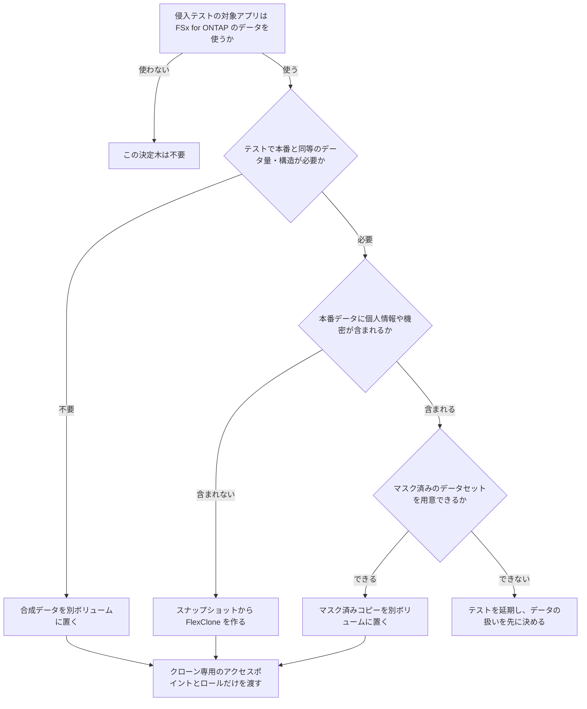

# Continuum と Security Agent の時代にストレージ層で決めておくこと / Storage-Layer Decisions in the Age of Continuum and Security Agent

## 結論 / Conclusion

AWS Continuum と AWS Security Agent は、アプリケーションとコードの脆弱性を機械の速度で見つけ、検証し、修復する仕組みです。FSx for ONTAP のストレージ設定そのものを評価する機能は、AWS の文書に記載がありません [E-026]。したがってストレージ側では、次の 3 点を自分で決めます。

1. 侵入テストにどのデータを触らせるか（決定木 1）
2. 侵入テスト中に、ストレージ層のどの検知が反応するか（決定木 2）
3. 自動修復の段階を上げるとき、データ側のどこへ戻れるようにしておくか（決定木 3）

実装は [`templates/pentest-isolation.yaml`](../../templates/pentest-isolation.yaml)（cfn-lint 通過、未デプロイ）と [手順書](../runbooks/pentest-clone-isolation.md) にあります。**Continuum 自体は実機で試していません。** 侵入テストとコード脆弱性は GA（後述の表）ですが、サインアップやセットアップの手順は確認していません。

AWS Continuum and AWS Security Agent find, validate and remediate application and code vulnerabilities at machine speed. The AWS documents read here do not list FSx for ONTAP storage configuration among the things they evaluate [E-026]. Three decisions therefore stay on the storage side: which data a penetration test may touch (tree 1), which storage-layer detections react during a test (tree 2), and where data can be rolled back to as automated remediation is raised a stage (tree 3). The implementation is `templates/pentest-isolation.yaml` (passes cfn-lint, not deployed) and the linked runbook. **Continuum itself was not tried here.** Penetration testing and code vulnerabilities are GA (see the table below), though the sign-up and setup steps were not checked.

---

## 2 つの AWS 発表の要点 / What the Two AWS Posts Say

| 項目 / Item | Security Agent の侵入テスト記事 / Penetration-testing post | Continuum の発表 / Continuum announcement |
|---|---|---|
| 公開日 / Published | 2026-02-26（日本語訳を読了 / read the Japanese translation） | 2026-06-17（同上 / same） |
| 対象 / Target | 実行中の Web アプリと API。認証情報とソースコードを渡せる / Running web apps and APIs, with credentials and optional source | コードの脆弱性のライフサイクル全体。既存バックログも取り込む / The whole lifecycle of code vulnerabilities, including an existing backlog |
| 動き方 / How it works | 認証、ベースラインスキャン、定型タスクとガイド付き探索、決定論的検証と LLM による再検証 / Sign-in, baseline scans, fixed and guided exploration, deterministic and LLM-based re-validation | 発見、優先順位付け、検証、緩和と修復の 4 フェーズ / Discover, prioritise, validate, mitigate and remediate |
| 自動化の度合い / Autonomy | 検出結果を CVSS で採点しレポート化 / Findings scored with CVSS and reported | learn モード（人が確認）から enforce モード（カテゴリ単位で自動修復）へ段階的に / From learn mode (human in the loop) to enforce mode (automated per category) |
| 提供状態 / Status | 記事の時点はパブリックプレビュー。侵入テストは 2026-03 に GA（6 リージョンで開始、2026-09 に 6 リージョン追加）/ Public preview at the post's date; penetration testing reached GA in 2026-03 (6 regions, +6 more in 2026-09) | code vulnerabilities は 2026-10-22 に GA（米国東部バージニア北部・米国西部オレゴン）。threat modeling・code scanning・design review はプレビューのまま / Code vulnerabilities reached GA on 2026-10-22 (US East N. Virginia, US West Oregon); threat modeling, code scanning and design review remain preview |
| AWS 自身の報告値 / AWS-reported figure | CVE Bench v2.0 で攻撃成功率 92.5%（グレーダー付き）、80%（グレーダーなし）、65%（学習データ以前の知識のみ）。AWS の評価であり、本書では再現していない / Attack success rate 92.5% with grader feedback, 80% without, 65% with an older model; AWS's own evaluation, not reproduced here | なし / none |

出典 / Sources: [Continuum 発表（日本語訳）](https://aws.amazon.com/jp/blogs/news/introducing-aws-continuum-security-at-machine-speed/)、[Security Agent 侵入テスト解説（日本語訳）](https://aws.amazon.com/jp/blogs/news/inside-aws-security-agent-a-multi-agent-architecture-for-automated-penetration-testing/)、[AWS Security Agent ユーザーガイド](https://docs.aws.amazon.com/securityagent/latest/userguide/what-is.html)（いずれも 2026-11-04 に全文を確認 / all read in full on 2026-11-04）、[AWS Security Agent on-demand penetration testing GA](https://aws.amazon.com/about-aws/whats-new/2026/03/aws-security-agent-ondemand-penetration/)、[AWS Continuum for Penetration Testing、6 リージョン追加](https://aws.amazon.com/about-aws/whats-new/2026/09/aws-continuum-penetration/)、[AWS Continuum for code vulnerabilities GA（日本語訳）](https://aws.amazon.com/jp/blogs/news/aws-continuum-for-code-vulnerabilities-is-now-generally-available/)（いずれも 2026-11-04 確認）。

**本書は当初、Continuum for code vulnerabilities を限定プレビューと書いていました。2026-10-22 に GA になったため、2026-11-04 の見直しで訂正しています** [E-027]。提供状態は変わるので、本番導入の前に AWS Region table で確認してください。コード脆弱性のリージョン（米国東部バージニア北部・米国西部オレゴン）は、AWS の発表本文ではなく第三者の記事経由で確認したものなので、採用前に Region table で引き直してください。

**This document originally described Continuum for code vulnerabilities as limited preview. It reached GA on 2026-10-22, and this correction was made on 2026-11-04** [E-027]. Availability changes; check the AWS Region table before adopting. The regions for code vulnerabilities (US East N. Virginia, US West Oregon) were confirmed through a third-party article rather than the AWS post itself; re-check against the Region table before relying on them.

侵入テストの接続方法は 2 通りあります。公開されたアプリには、検証済みドメインに対して外部から到達します。公開されていないアプリには、指定した VPC のサブネットにエージェント用のネットワークインターフェイスを作って到達します（[Connect agent to private VPC resources](https://docs.aws.amazon.com/securityagent/latest/userguide/connect-agent-vpc.html)）。後者で使うセキュリティグループは利用者が選べるので、ストレージ側の隔離はここから始まります。

A penetration test reaches a public application from outside against a verified domain. For a non-public application, the agent creates a network interface in a subnet you choose and attaches the security groups you choose. That choice is where storage-side isolation starts.

---

## ストレージ層に残る役割 / What Remains for the Storage Layer

脆弱性の検出と修復が速くなっても、修復が適用されるまでの間は攻撃経路が開いています。その間に悪用されたとき、被害をデータの範囲で止めるのはストレージ層です。この文書は、その層の制御を並べ直しません。脅威の型ごとの対応は [フレームワークマッピング](../ja/cyber-resilience-framework-mapping.md)（[EN](../en/cyber-resilience-framework-mapping.md)）にあり、ここでは複製しません。

Faster discovery and remediation do not close the window before a fix lands. If a flaw is exploited in that window, the storage layer is what bounds the damage to data. This document does not restate those controls; the per-threat mapping is in the framework mapping.

侵入テスト自体も、データに触る攻撃者の役を演じます。書き込み、大量読み取り、IDOR による他者データの参照を試すので、**本番と同じボリュームに向けると、テストが障害になります。**

A penetration test also plays an attacker that touches data: it writes, reads in bulk and tries other users' data through IDOR. **Pointed at the production volume, the test itself becomes the incident.**

---

## 決定木 1: 侵入テストにどのデータを触らせるか / Tree 1: Which Data a Penetration Test May Touch

| 選択肢 / Option | 向く条件 / Suited when | 制約・トレードオフ / Constraints and trade-offs |
|---|---|---|
| 本番ボリュームに直接 / Production volume directly | 選ばない / Not recommended | テストの書き込みと削除が本番に残る。ARP とアラートが本番の運用と混ざる / Test writes and deletes land in production; ARP alerts mix with real operations |
| FlexClone（スナップショットから作る書き込み可能な複製）/ FlexClone | 本番と同じ構造・量で試したい。個人情報を含まない、または含んでも取り扱いが承認済み / Same shape and size as production; no personal data, or handling approved | 親スナップショットを共有するので、クローンが残る間は親側の整理に影響しうる（`volume snapshot show -fields busy,owners` で確認）。クローンにも本番のデータが入る / Shares the parent snapshot, so cleanup of the parent can be affected while the clone exists; the clone still holds production data |
| 合成データの別ボリューム / Synthetic data on a separate volume | 構造だけ合えばよい。繰り返し実行する / Shape is enough; repeated runs | 本番固有のデータ依存の脆弱性を見逃しうる / Can miss flaws that depend on production-specific data |
| マスク済みコピー / Masked copy | 本番相当で、個人情報を含められない / Production-like but personal data cannot be included | マスク処理の構築と検証が別に要る。この文書では扱わない / Needs its own build and validation; out of scope here |

**クローンの注意 / Clone caveats**
- クローンを切っても、アプリのロールが本番のアクセスポイントに届けば隔離になりません。テンプレートは、アプリのロールをクローン用アクセスポイントだけに許可し、本番用アクセスポイントを明示的に拒否します。
- クローン作成時の ARP の状態は引き継がれるか未測定です。作成後に `security anti-ransomware volume show` で読み直します。
- A clone does not isolate anything if the application's role can still reach the production access point; the template allows the role on the clone's access point only and denies the production one explicitly. Whether a clone inherits the ARP state is not measured, so read it back after creation.

---

## 決定木 2: 侵入テスト中にどの検知が反応するか / Tree 2: Which Detections React During a Test

侵入テストは検知の予行演習にもなります。ただし、層ごとに見える経路が違います。

A penetration test doubles as a rehearsal for detection, but each layer sees different paths.

| テストの行為 / Test action | 見えうる層 / Layer that can see it | 根拠・状態 / Basis and status |
|---|---|---|
| NFS / SMB 経由の大量の書き込み・名前変更・削除 / Bulk writes, renames, deletes over NFS / SMB | ARP、FPolicy / ARP, FPolicy | ARP の操作レート入力は過去値との比較であり、履歴のないボリュームには比較対象がない [E-005] / ARP rate inputs compare with history, which a fresh volume lacks |
| S3 Access Points 経由の書き込み / Writes through S3 Access Points | ARP | 高エントロピーの書き込みは検知を実測済み（2026-08-26、ONTAP 9.18.1P3D1）。他の入力は未測定 / Detection of high-entropy writes measured; other inputs not |
| S3 Access Points 経由の操作 / Operations through S3 Access Points | FPolicy には届かない / Not seen by FPolicy | 実測、同じ環境 [E-015] / measured, same build |
| 大量の読み取り・他者データの参照 / Bulk reads, other users' data | 監査ログと SIEM / Audit log and SIEM | ARP は読み取りだけでは発火する条件が文書にない [E-012]。S3 Access Points 経由では要求者を監査ログから特定できない [E-018] / No documented read-only ARP condition; the requester is not recoverable from the audit log on the S3 path |
| アプリ層の SQL や認可判断 / SQL and authorisation decisions in the app | ストレージ層からは見えない / Not observable from storage | [E-013] |

**テスト前に決めること / Decide before the test**
1. セキュリティ運用側へテストの時間帯と対象を通知するか。通知するなら、アラートが予行演習の成果かを後から区別できます。通知しないなら、運用側の反応時間が測れますが、自動隔離（`Quarantine`）が走る前提でクローンを使います。
2. クローン上で ARP を有効にするか。有効にするとテストの書き込みで検知を観測できますが、ARP の無効化は即時ではなく、`disable_in_progress` が 10 分以上続いた観測があります [E-004]。使い捨てのクローンなら、無効化せずクローンごと削除します。
3. 監査の SACL をクローン側に付けるか。付けなければ、S3 Access Points 経由の読み取りは記録されません [E-018]。

1. Notify the security operations side or not; notifying lets you separate rehearsal alerts later, not notifying measures response time. 2. Enable ARP on the clone or not; disabling is not immediate (`disable_in_progress` lasted over 10 minutes in one observation), so for a throwaway clone delete the clone instead. 3. Put the audit SACL on the clone or not; without it, reads through S3 Access Points are not recorded.

---

## 決定木 3: 自動修復の段階を上げるときの戻り先 / Tree 3: Where to Roll Back When Raising Remediation Autonomy

Continuum は learn モードから始まり、利用者が信頼を持った段階で enforce モードに上げます。修復の内容として記事が挙げるのは、ネットワークの変更、ポリシーの変更、コードパッチです。ストレージのデータを直接書き換える記載はありません。それでも、悪用された脆弱性や誤った修復の結果としてデータが壊れたときに、戻る先はストレージ側に用意が必要です。

Continuum starts in learn mode and moves to enforce mode as trust grows. The post lists network changes, policy changes and code patches as remediation; it does not describe writing to storage data. Data can still be damaged by an exploited flaw or a faulty fix, and the way back has to be prepared on the storage side.

| 段階 / Stage | Continuum 側の状態 / Continuum state | ストレージ側で用意するもの / Storage-side preparation | 戻り先 / Rollback target | 不可逆性 / Irreversibility |
|---|---|---|---|---|
| 1. learn | 推奨のみ。人が適用 / Recommendations only | 通常のスナップショットポリシー / Regular snapshot policy | スナップショットからの FlexClone / SnapRestore | なし / none |
| 2. enforce（低リスクのカテゴリ）/ enforce, low-risk categories | 定義したカテゴリだけ自動適用 / Automated for defined categories | 適用の直前と直後にスナップショットを取る運用 / Snapshots just before and after each change window | 直前のスナップショット / The snapshot before the window | なし / none |
| 3. enforce（広いカテゴリ）/ enforce, broad categories | 自動適用の範囲が広い / Wide automated scope | Tamperproof Snapshot で復旧点を管理者でも消せなくする / Locked snapshots that administrators cannot delete | ロック済みスナップショットからの FlexClone / FlexClone from a locked snapshot | **ロックは期間満了まで戻せない。保持期間の値と影響範囲を先に承認する** / **The lock cannot be undone until expiry; approve the period and its blast radius first** |
| 4. アカウントやファイルシステム全体の侵害を想定 / Whole-account or file-system compromise | 段階 3 までと同じ / same as stage 3 | 別アカウントへのコピーまたは AWS Backup の論理エアギャップボールト / Cross-account copy or a logically air-gapped vault | ボールトまたは別アカウントからの復元 / Restore from vault or the other account | ボールトは作成時にキーとロックモードが固定される [E-020] / Key and lock mode fixed at creation |

選び方の基準 / How to choose:
- 修復の誤りがデータに及ぶ余地がない段階では、1 と 2 で足ります。
- 管理者権限の窃取を想定するなら 3。ロックの保持期間は不可逆なので、承認の取り方は [Adoption Playbook](https://github.com/Yoshiki0705/FSx-for-ONTAP-Adoption-Playbook/blob/main/docs/ja/domains/data-protection/README.md) にあります。
- アカウントやファイルシステムごとの侵害まで含めるなら 4。比較は [AWS Backup 論理エアギャップボールト](../data-protection/aws-backup-logically-air-gapped-vault.md) と [層の比較](../comparison-security-layers.md)。
- Stages 1 and 2 suffice while a faulty fix cannot reach data. Choose 3 if administrator credential theft is in scope; the lock period is irreversible. Choose 4 if whole-account or file-system compromise is in scope.

**承認ゲートについて / On approval gates**: ONTAP の複数管理者承認（MAV）を、この決定木の承認手段には含めません。FSx for ONTAP の `fsxadmin` で有効化できるかは確認できておらず [E-025]、オンプレミス ONTAP では文書化された機能です。承認が必要な操作は、Step Functions の承認ワークフロー（[ランサムウェア復旧手順書](../runbooks/ransomware-recovery.md)）と AWS Backup のマルチパーティ承認で組みます。

MAV is left out of this tree as an approval mechanism: whether `fsxadmin` can enable it on FSx for ONTAP is not established [E-025], while it is documented for on-premises ONTAP. Build approvals with the Step Functions workflow and AWS Backup multi-party approval instead.

---

## プラットフォーム別の対応 / Platform Notes

オンプレミスの ONTAP や、他のクラウドの ONTAP ベースのサービスでも、決定木 1 と 3 の考え方は共通です。違うのは、使える機能と、確認できている範囲です。

The reasoning of trees 1 and 3 carries over to on-premises ONTAP and ONTAP-based services in other clouds. What differs is the features available and how much is established.

| 項目 / Item | FSx for ONTAP | オンプレミス ONTAP / On-premises ONTAP | Cloud Volumes ONTAP | Google Cloud NetApp Volumes | Azure NetApp Files |
|---|---|---|---|---|---|
| スナップショットから書き込み可能な複製 / Writable copy from a snapshot | FlexClone（本リポジトリの手順書で使用）/ FlexClone | FlexClone | 未確認 / not checked | 文書化あり。新しいボリュームを作る。Flex Unified の thin clone は元のボリュームとスナップショットを削除できなくする / Documented; a new volume; Flex Unified thin clones block deleting the source volume and snapshot | 文書化あり。「Restore to new volume」。作成中は一部のレプリケーションが停止する / Documented; some replication suspended while restoring |
| 複数管理者承認（MAV）/ Multi-admin verification | 未確立 [E-025] / not established | 文書化あり（9.11.1 以降、TR-4569）/ Documented from 9.11.1 | サポート対象外（9.15.1 のリリースノート）[E-024] / Not supported (9.15.1 release notes) | 未確認 / not checked | 未確認 / not checked |
| 実機での確認 / Run on real environment | 東京リージョンで ARP 等を実測済み。クローン隔離は未実施 / ARP etc. measured in Tokyo; clone isolation not run | なし / none | なし / none | なし。文書の読み取りのみ / none; documentation only | なし。文書の読み取りのみ / none; documentation only |

「未確認」は、その機能がないという意味ではなく、この文書では文書を読んでいないという意味です。GCNV と ANF については、実機の記録が存在しないため、文書化の水準を超える記述をしません。

"Not checked" means this document did not read the relevant page, not that the feature is missing. For Google Cloud NetApp Volumes and Azure NetApp Files, no run exists, so nothing here goes beyond what the documentation says.

---

## 実装 / Implementation

| 成果物 / Artifact | 内容 / What it does | 状態 / Status |
|---|---|---|
| [`templates/pentest-isolation.yaml`](../../templates/pentest-isolation.yaml) | エージェント用とアプリ用のセキュリティグループ、クローン専用のアプリロール、エージェント用 VPC 権限 / Agent and application security groups, clone-only application role, agent VPC permissions | cfn-lint 通過。未デプロイ。侵入テストでは未使用 / Passes cfn-lint; not deployed; not used in a test |
| [`docs/runbooks/pentest-clone-isolation.md`](../runbooks/pentest-clone-isolation.md) | クローンの作成、アクセスポイントの接続、テスト前後の確認、撤去 / Clone creation, access point attach, checks before and after, teardown | 手順は ONTAP と AWS の文書に基づく。実機では通していない / Based on documentation; not run end to end |

---

## 確認できていないこと / What Is Not Established

- Continuum が FSx for ONTAP の設定をコンテキストとして取り込むか。取り込む場合の範囲も不明 [E-026]
- クローンに ARP の状態が引き継がれるか
- `fsxadmin` で MAV を有効化できるか [E-025]。読み取りの確認コマンドは台帳にあります
- Security Agent の侵入テストを FSx for ONTAP のクローンを使うアプリに実行した結果
- Google Cloud NetApp Volumes と Azure NetApp Files の ARP、スナップショットのロック、MAV の有無

- Whether Continuum ingests FSx for ONTAP settings as context, and how far; whether a clone inherits ARP state; whether `fsxadmin` can enable MAV; the outcome of a real Security Agent test against an application on a clone; and ARP, snapshot locking and MAV on the other two cloud services.

---

## 参照 / References

- [Adoption Playbook: AWS Security Agent はアプリを検証し、FSx for ONTAP の設定は検証しない](https://github.com/Yoshiki0705/FSx-for-ONTAP-Adoption-Playbook/blob/main/docs/ja/ai-agents/security-agent/README.md)（Hub の結論。本書はこれを前提にストレージ側の決定を補う / the Hub's conclusion, which this document builds on）
- [Adoption Playbook: 管理面の保護は複数の制御の組み合わせで決まる](https://github.com/Yoshiki0705/FSx-for-ONTAP-Adoption-Playbook/blob/main/docs/ja/domains/security-governance/notes/admin-plane-protection-depends-on-several-controls.md)（MAV の位置づけ / MAV)
- [Cloud Volumes ONTAP 9.15.1 リリースノート: 制限事項](https://docs.netapp.com/us-en/cloud-volumes-ontap-9151-relnotes/reference-limitations.html)
- [Google Cloud NetApp Volumes: Create a new volume from a snapshot](https://docs.cloud.google.com/netapp/volumes/docs/configure-and-use/volume-snapshots/new-volume-from-snapshot)
- [Azure NetApp Files: Restore a snapshot to a new volume](https://learn.microsoft.com/en-us/azure/azure-netapp-files/snapshots-restore-new-volume)
- [ARP 設定](../ontap-native/arp-configuration.md)、[Tamperproof Snapshot](../ontap-native/tamperproof-snapshot.md)、[ランサムウェア復旧手順書](../runbooks/ransomware-recovery.md)、[持ち出し対応の手順書](../runbooks/data-exfiltration-response.md)
